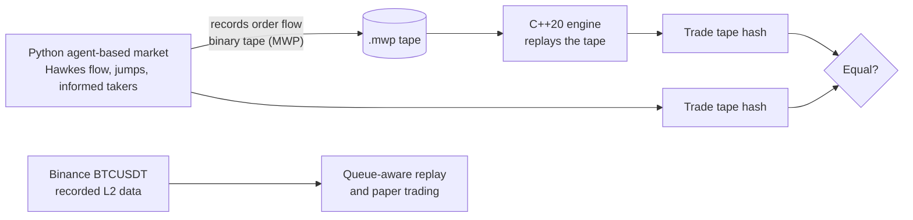
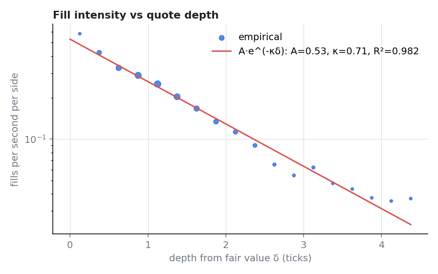
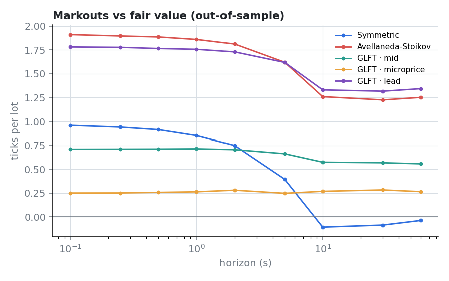
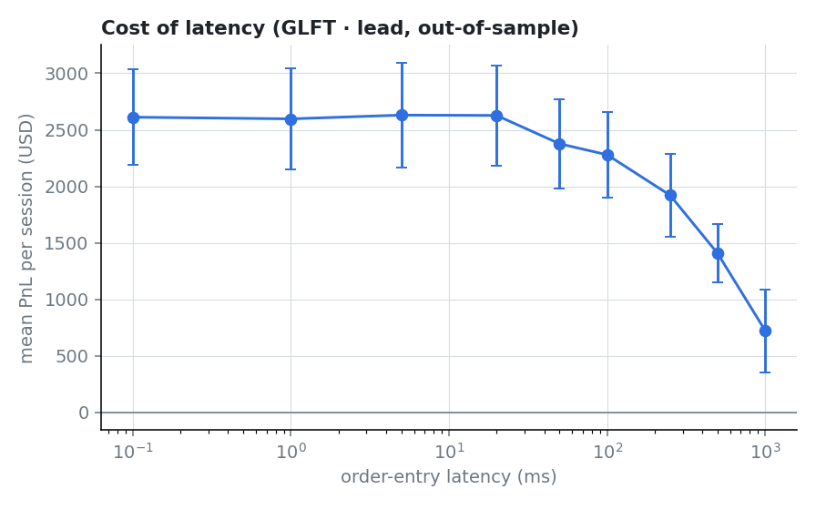
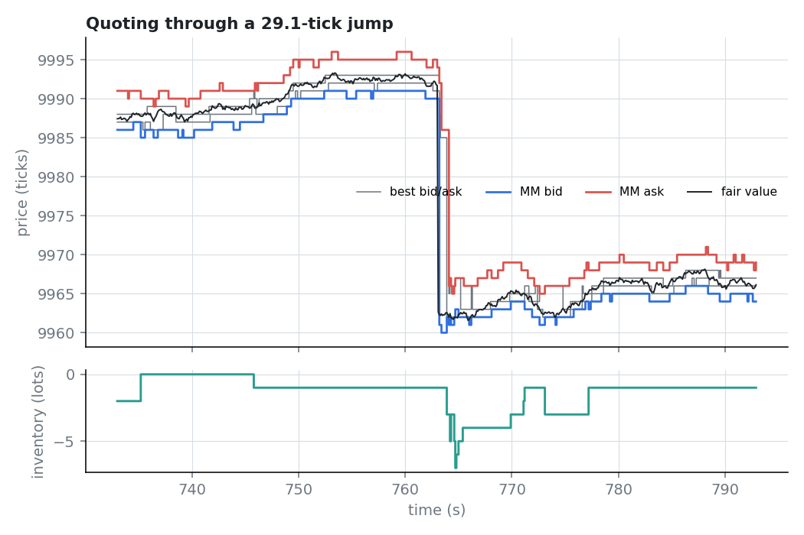
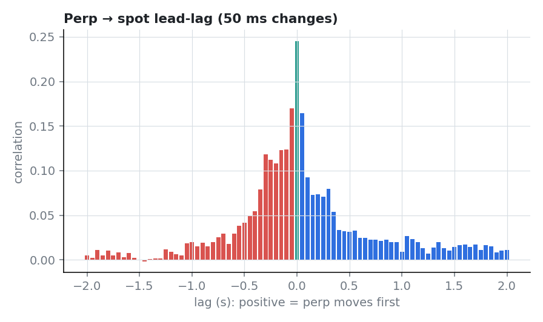
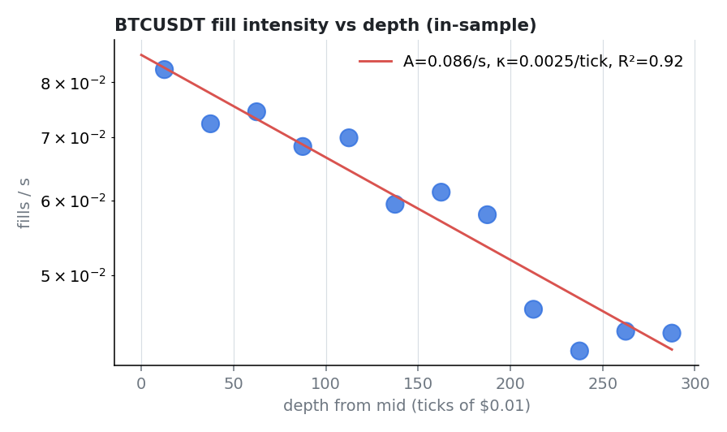
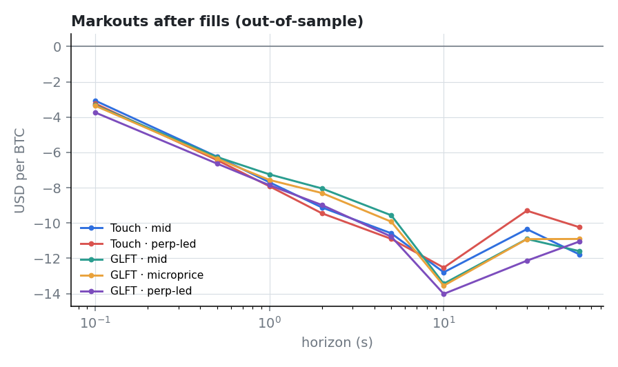
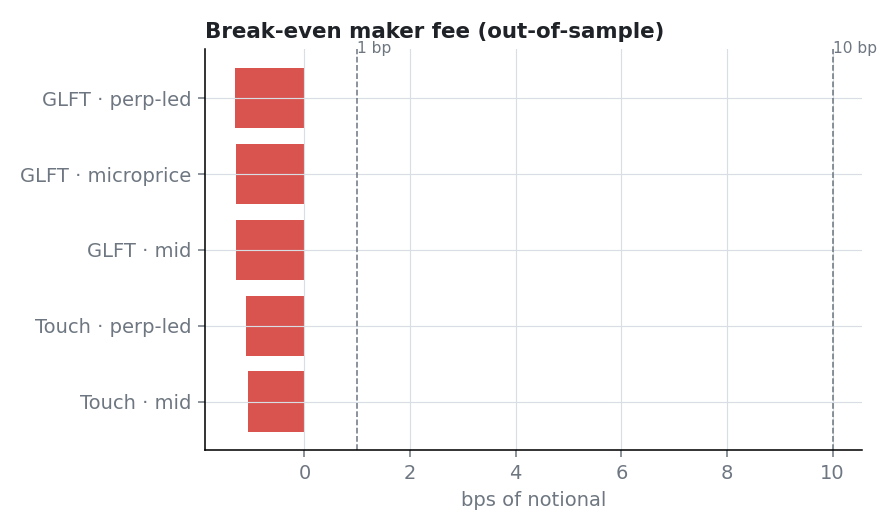

# Meridian

[](https://github.com/xakii-112/meridian/actions/workflows/ci.yml)


An electronic market-making stack in two halves that check each other:

* **`engine/`** — a header-only C++20 limit order book matching engine: price-time priority,
  IOC / FOK / post-only / self-trade prevention, cancel/replace, a pre-trade risk gate, a fixed-frame
  binary protocol and gateway. **~30 ns median, ~450 ns p99.9 per message, 25.7 M msg/s, zero heap
  allocations on the hot path, bit-identical output on every replay.**
* **`research/`** — a Python agent-based market (jump-diffusion fair value, background liquidity,
  Hawkes noise flow, zero-latency arbitrageurs, informed takers) used to calibrate and compare
  market-making strategies (Symmetric, Avellaneda–Stoikov, Guéant–Lehalle–Fernandez-Tapia) on
  disjoint in-sample / out-of-sample seeds, plus a latency study.

The simulator records its full order flow in the engine's wire format; the C++ engine replays it and
must reproduce the **same trade tape, hashed to the same 64-bit value**. It does.




Interactive report with a live, tunable market maker running in the browser: open
[`dashboard/index.html`](dashboard/index.html) from a clone (one self-contained file, no server).
The dollar and Sharpe figures on its first screen come from the **synthetic** market; real-data
results are below.

> **Read the numbers correctly.** Sharpe ratios around 50 below are from a simulated market with no
> competing fast makers and a perfect lead price; they compare strategies and are not a claim about
> trading profits. On **real** Binance data every strategy lost money, even before fees.

> **Özet (TR).** Meridian, Jane Street / Citadel Securities tarzı elektronik piyasa yapıcılığın iki
> çekirdeğini birlikte kurar: (1) C++20 ile yazılmış, mesaj başına ~30 ns medyan gecikmeli, sıcak
> yolda hiç bellek ayırmayan, deterministik bir emir defteri eşleştirme motoru ve risk kapısı;
> (2) Python'da, Hawkes emir akışı, sıçramalı fair value, arbitrajcılar ve bilgili alıcılar içeren ajan
> tabanlı bir piyasa simülatörü ile GLFT / Avellaneda–Stoikov stratejilerinin kalibrasyonu,
> in-sample/out-of-sample karşılaştırması ve gecikme maliyeti analizi. Simülasyonun emir akışı C++
> motorunda tekrar oynatılır ve işlem bandının hash'i bire bir aynı çıkar. Canlı, ayarlanabilir
> market maker içeren interaktif rapor `dashboard/index.html` dosyasındadır. Ayrıca Binance BTCUSDT'nin 90
> dakikalık gerçek L2 verisi kaydedildi, emir defteri doğrulanarak yeniden kuruldu ve stratejiler bu
> veride kuyruk modeliyle tekrar oynatıldı: hiçbiri ücretlerden önce bile kâr etmiyor (BTC başına
> −$8.7 ile −$10.8), pasif dolumlar 1 saniyede ortalama −$7.25/BTC kaybettiriyor.

---

## Headline results

Measured on an AMD Ryzen 7 7435HS (Windows 11, clang 23.1.3, `-O3 -march=native`, thread pinned).

**Engine latency** — 5 M messages after 0.5 M warm-up, ~10k orders resting (`results/bench.json`):

| ns | p50 | p90 | p99 | p99.9 | p99.99 |
|---|---:|---:|---:|---:|---:|
| all messages | 30 | 70 | 169 | 452 | 644 |
| add (passive) | 30 | 70 | 161 | 421 | 613 |
| add (marketable) | 40 | 90 | 211 | 463 | 719 |
| cancel | 20 | 40 | 151 | 452 | 623 |
| replace | 40 | 60 | 180 | 484 | 708 |
| all, with risk gate | 40 | – | 180 | 463 | – |

Throughput replaying the recorded 5.5 M-message tape: **25.7 M msg/s**. Heap allocations inside the
timed region: **0**. This CPU's TSC advances in ~10 ns steps, so sub-10 ns differences are not resolved.

**Strategies on the synthetic market, out of sample** — 16 one-hour sessions each, every session with its own volatility and
flow regime (`results/study.json`):

| Strategy | PnL / h (USD) | ± s.e. | Sharpe (ann.) | Win | Edge / lot (ticks) | Net / lot | mean \|q\| | Markout 10 s |
|---|---:|---:|---:|---:|---:|---:|---:|---:|
| Symmetric | −262 | 800 | −3.3 | 56% | 0.74 | −0.01 | 25.4 | −0.11 |
| Avellaneda–Stoikov | 2,358 | 399 | 60.2 | 100% | 1.56 | 1.46 | 1.9 | 1.26 |
| GLFT · mid | 1,497 | 314 | 48.6 | 100% | 1.87 | 0.79 | 0.9 | 0.57 |
| GLFT · microprice | 1,009 | 276 | 37.3 | 88% | 1.63 | 0.49 | 1.0 | 0.27 |
| **GLFT · lead** | **2,630** | 465 | 57.7 | 100% | 1.58 | 1.54 | 1.3 | 1.33 |

What the study shows:

1. **Inventory control is the difference between losing and making money.** The symmetric quoter
   captures spread but carries ~25 lots of inventory into informed flow and loses it all back; its
   best in-sample setting (+$1,892/h) does not survive out of sample.
2. **Where you centre the quotes matters more than how you size them.** The same GLFT model earns
   $2,630/h centred on the lead (fair) price, $1,497 on the book mid and $1,009 on the microprice:
   fills against a stale reference are already adverse at the moment they print.
3. **GLFT and Avellaneda–Stoikov are statistically tied** on Sharpe once each is tuned on its own grid;
   GLFT has the higher mean PnL and keeps less inventory.
4. **Latency is free until it isn't.** PnL is flat from 0.1 ms to 20 ms, then falls: −13% at 100 ms,
   −46% at 500 ms, −72% at 1 s, as quotes left on the book after news are picked off by arbitrageurs.
5. Calibration: λ(δ) = 0.53 · e^(−0.71 δ) fills/s (R² = 0.98), σ = 1.01 ticks/√s; the Sharpe-optimal
   GLFT risk aversion γ* = 0.2 gives a 1.70-tick flat half-spread and a 0.92-tick skew per 2-lot unit.

**Verification**: 97/97 C++ tests (also clean under ASan + UBSan), 41/41 Python tests, and the
differential replay `0x35cedb7192ed0cba` (Python) == `0x35cedb7192ed0cba` (C++) over 95,229 messages
and 18,383 trades.

| | |
|---|---|
|  |  |
|  |  |

---

## Real data: Binance BTCUSDT

90 minutes of Binance's public market data, 2026-10-23 12:40–14:10 UTC (5.05 M messages): spot
BTCUSDT L2 depth diffs every 100 ms, every trade and every best-quote change, REST snapshots, and
the USD-M perpetual's best quotes and trades. No API keys; no order was sent. The first half is
used for calibration and tuning, the second half is out of sample (`results/real/real_study.json`).

**Book reconstruction.** Snapshot + diff stream with Binance's sequence rules: 0 sequence gaps, and
0 of 31,206 levels within $200 of the touch differed from 17 audit snapshots rolled forward to the
same update id. Over the full depth, 6,557 of 169,984 compared levels differ (3.9%), all more than
$200 from the touch: deep levels outside the 5,000-level window of the snapshot the book started
from, which no diff has touched since.

**The market.** Price ≈ $81,860; the spread is one tick ($0.01) 99.6% of the time with a median
2.7 BTC at the touch; volatility $4.84/√s (33% annualised), and the second half was 2.2× as
volatile as the first; $57 M of spot volume per hour, 4.9 taker orders/s. Taker arrivals are
strongly self-exciting (Hawkes branching ratio 0.29, kernel half-life 6 ms, no cross-excitation;
log-likelihood 812 against −4,700 for Poisson).

**What resting liquidity earns** — the maker side of all 153,617 out-of-sample trades, marked to
the spot mid (USD per BTC):

| horizon | 0.1 s | 1 s | 10 s | 60 s |
|---|---:|---:|---:|---:|
| all trades | −3.82 | −7.25 | −7.08 | −6.66 |
| perp gap with the maker | −3.37 | −6.31 | −6.42 | −4.74 |
| perp gap against the maker | −4.54 | −8.47 | −5.18 | −9.02 |

The half-spread is worth $0.005 per BTC; one second after a fill the average maker is down 1,450
times that. In the first half, splitting by the perp-implied gap separated fills by $10.4/BTC at
1 s; with the same cut-offs on the second half the separation was $2.2. The signal exists (the gap
predicts the next second of spot with correlation 0.21) but its strength did not carry over.

**Lead-lag.** On 50 ms mid changes the contemporaneous correlation is 0.25 and the spot-first side
slightly outweighs the perp-first side (1.32 vs 1.23 summed over lags). The perp feed reached this
machine 38 ms later than spot relative to exchange timestamps (median receive delay 427 ms spot,
465 ms perp, network plus clock offset), so in this session price discovery ran both ways.

**Fill intensity.** Probe quotes give λ(δ) = 0.086 · e^(−0.0025 δ) fills/s (R² = 0.92): the rate
only halves at $2.8 from the mid, because with σ ≈ 285 ticks/√s most fills come from the price
moving onto the quote. The GLFT closed form therefore quotes about $14 either side of the mid.

**Strategies, out of sample** (0.001 BTC quotes, 0.01 BTC limit, 200 ms round trip, gross of fees):

| Strategy | Gross $/h | ± s.e. | Fills | Edge / BTC | Break-even fee |
|---|---:|---:|---:|---:|---:|
| Touch · mid | −12.10 | 2.66 | 1,049 | −8.69 | −1.06 bp |
| Touch · perp-led | −12.13 | 2.63 | 1,009 | −9.10 | −1.11 bp |
| GLFT · mid | −2.61 | 0.45 | 200 | −10.58 | −1.29 bp |
| GLFT · microprice | −2.66 | 0.47 | 204 | −10.55 | −1.29 bp |
| GLFT · perp-led | −2.85 | 0.44 | 203 | −10.83 | −1.32 bp |

None is profitable even before fees; Binance's standard spot fee for a regular account (10 bp) adds
about $82 of cost per BTC on top. The virtual fills' markouts (−$7.2 to −$7.9 per BTC at 1 s)
match what the market's real makers experienced (−$7.25), a useful check that the queue model is
neither flattering nor punishing. Latency makes it worse monotonically: GLFT · mid loses $0.84/h at
1 ms and $4.12/h at 1 s round trip. The conservative queue model (cancellations never advance the
queue) changes the result by 4%.

What this means: on Binance spot BTCUSDT a slow, fee-paying passive quoter is the counterparty of
better-informed flow. Making it work would need maker rebates or zero-fee tiers, co-located
latency, and a lead signal that holds up out of sample, none of which the recording supports.

| | |
|---|---|
|  |  |
|  |  |

### Live paper trading

`meridian_research.binance.paper` runs the same `MarketMaker` on Binance's live public streams with
virtual orders: the spot book is rebuilt in real time by the same `Decoder` the preprocessing uses,
quotes queue behind real liquidity and fill only when real trades reach them, and a status line
shows the quotes, the queue ahead of each, position, fills, gross and fee-adjusted PnL. There is no
order-entry code in the project and no API key is ever used.

```bash
python -m meridian_research.binance.paper --minutes 15 --record                 # champion strategy
python -m meridian_research.binance.paper --pick "Touch · perp-led" --minutes 15 --record
python -m meridian_research.binance.paper --replay ../results/paper/<paper_session> --verify
```

Determinism carries over to live trading: `--record` saves each raw message as it is processed, and
`--replay` pushes the recording through the identical code path, so the offline run reproduces the
live session fill for fill; `--verify` additionally checks it against the array backtest
(`backtest.run`). The refactor that made the engine event-driven was itself checked the same way:
seven configurations on the 90-minute recording gave bit-identical results before and after.

Two live sessions, 2026-10-23 16:16–16:31 UTC, 15 minutes of quoting each, 200 ms modelled round
trip (`results/paper/`):

| Session | Fills | BTC | Gross | Net @ 10 bp | Edge / BTC | Markout 1 s / 10 s | Replay = live |
|---|---:|---:|---:|---:|---:|---:|:---:|
| GLFT · mid | 6 | 0.006 | −$0.11 | −$0.60 | −$18.27 | −$3.69 / −$15.37 | exact |
| Touch · perp-led | 113 | 0.109 | −$0.76 | −$9.67 | −$6.95 | −$4.91 / −$12.60 | exact |

The live sessions behave like the replay study: fills are followed by adverse moves, the edge per
BTC is negative before fees, and the 10 bp fee dominates the net result. Replaying each session's
recording reproduced its live fills and PnL exactly and matched `backtest.run` fill for fill.

---

## Repository layout

```
engine/                      C++20, header-only core (CMake + Ninja)
  include/meridian/
    types.hpp                ticks/lots/ids, commands, the fixed-size Event record
    bitset.hpp               64-ary hierarchical bitset (next/prev non-empty level)
    event_buffer.hpp         per-command output tape, reused storage
    order_book.hpp           the book: ladder, intrusive FIFOs, arena, matching rules, audit
    matching_engine.hpp      multi-instrument routing, risk hook, tape hash
    risk.hpp                 pre-trade risk gate and exposure tracking
    wire.hpp                 MWP binary protocol (48-byte in / 64-byte out frames, tape files)
    gateway.hpp              frame decoding, (owner, clOrdId) -> order id flat map, exec reports
  tests/                     GoogleTest: scenarios, risk, wire, bitset, differential fuzzing
  bench/bench_engine.cpp     TSC latency histograms, allocation counter, throughput replay
  tools/replay.cpp           replays an .mwp tape, prints JSON incl. the tape hash
research/                    Python 3.11+, numpy (matplotlib optional)
  meridian_research/
    lob.py                   order book with the engine's exact semantics and tape hash
    wire.py                  MWP tape writer
    hawkes.py                multivariate Hawkes simulation (Ogata thinning)
    market.py                the agent-based market simulator
    strategies.py            Symmetric, Avellaneda-Stoikov, GLFT, calibration probe
    calibration.py           fill-intensity fit, realised volatility
    analytics.py             PnL attribution, markouts, drawdown, Sharpe
    study.py                 the full pipeline (parallel), writes results/
    figures.py               static figures
    binance/
      recorder.py            public Binance streams -> gzip JSON-lines chunks (no keys, no orders)
      data.py                Decoder: L2 reconstruction with sequence checks + audits -> events.npz
      backtest.py            MarketMaker: queue-aware virtual quotes, event-driven (replay or live)
      paper.py               live paper trading on the public streams (+ --record / --replay)
      calibrate.py           market stats, Hawkes MLE, lead-lag, realised spreads, feed delays
      study.py               in-sample calibration/tuning, out-of-sample evaluation
  tests/                     pytest, including C++ cross-checks and queue-model cases
dashboard/                   template.html + build.py -> index.html (the published report)
results/                     bench.json, study.json, tests.json, figures/
```

## Engine design

**Data layout.** Prices are integer ticks; the book is one ladder indexed by `price - min_price`
shared by both sides (a resting book is never crossed, so a level holds bids or asks, never both).
Each level is an intrusive doubly-linked FIFO of 48-byte order nodes in a preallocated arena; the
free list is threaded through the same `next` field. Order ids are `generation << 32 | slot`, so a
cancel is an array index plus a generation check that rejects stale ids after slot reuse — no hash
map on the hot path. A 64-ary summary bitset marks non-empty levels: the next best price after a
level empties is found by touching at most ⌈log₆₄ N⌉ words, independent of the gap.

**Matching rules.** Price-time priority at the resting order's price. Limit and market orders; GTC,
IOC and FOK (FOK pre-checks fillable quantity, honouring self-trade prevention); post-only rejects
instead of taking; self-trade prevention carried on the aggressor (cancel resting / cancel aggressor
/ cancel both). Replace sets a new price and leaves quantity: a size-down at the same price keeps
queue priority, anything else re-queues and may execute.

**Output.** Every command produces a short run of fixed-size `Event` records (accepted, rejected,
trade, cancelled, replaced, cancel/replace rejected, L2 book level) in a reused buffer, so the output
is a flat tape. The engine never reads a clock: timestamps come from the sequencer, which makes it a
pure deterministic state machine. Every trade is folded into a 64-bit FNV-style tape hash.

**Risk gate** (15c3-5 style) in fixed order: known participant, kill switch / global halt, message
throttle (integer token bucket on sequencer time), max order size, price collar around the last
trade (market orders become collared limits), max notional, max open orders, and worst-case
position = position + all resting same-side quantity + the new order. Exposure is updated from the
engine's own events, so it cannot drift from the book. Cancels always pass.

**Wire protocol (MWP).** 48-byte inbound frames (`O` enter, `X` cancel, `U` replace) and 64-byte
outbound frames, little-endian, every field at a fixed offset. Tape files add a 40-byte header.

## Research design

**Market.** Fair value: Brownian motion (σ = 0.8 ticks/√s) plus compound-Poisson news jumps (one per
90 s, mean 5 ticks), on a 10 ms grid. Agents: background LPs placing limit orders around fair value
with exponential lifetimes (they go stale); uninformed takers driven by a bivariate Hawkes process
(self 0.8, cross 0.3, β = 2); arbitrageurs with zero latency taking anything mispriced by ≥ 0.5 tick;
informed takers who know fair value 10 s ahead. Each session draws lognormal multipliers for
volatility, informed and noise intensity (dispersion 0.35), so sessions differ the way days do.

**Market maker.** Post-only 2-lot quotes, inventory limit 50 lots, $1 per tick per lot ($0.01 × 100
shares), 0.2 tick/lot maker rebate. It sees the lead (fair) price instantly, but every action reaches
the book after its latency (5 ms by default). It requotes on a 1 s timer, on every fill, and whenever
its reference moves by 0.35 tick, and keeps a quote untouched when the price is unchanged to preserve
queue priority. Mid and microprice references exclude its own quotes; without that, a mid-referenced
quoter chases its own inventory skew and loses heavily.

**Method.** (1) Calibrate λ(δ) = A e^(−κδ) from probe quotes placed at random depths and σ from
realised volatility. (2) Tune each family on 16 in-sample seeds (GLFT γ, A–S γ, Symmetric
half-spread), choosing by Sharpe. (3) Evaluate the tuned strategies on 16 different seeds.
(4) Sweep latency out of sample. (5) Record one session, replay it through the C++ engine.
649 sessions in ~90 s on all cores.

## Quick start

```bash
git clone https://github.com/xakii-112/meridian && cd meridian
cmake -S engine -B engine/build -G Ninja -DCMAKE_BUILD_TYPE=Release -DCMAKE_CXX_COMPILER=clang++
cmake --build engine/build
engine/build/meridian_tests                     # 97 tests
python -m pip install -e "research[dev,figures,real]"
cd research && python -m pytest                 # 41 tests, including the C++ cross-checks
```

## Reproduce

Requirements: CMake ≥ 3.25, Ninja, a C++20 compiler (clang ≥ 17 or gcc ≥ 13; on Windows
`winget install MartinStorsjo.LLVM-MinGW.UCRT`), Python ≥ 3.11 with numpy, pytest, matplotlib.
GoogleTest is fetched by CMake.

```bash
cmake -S engine -B engine/build -G Ninja -DCMAKE_BUILD_TYPE=Release -DCMAKE_CXX_COMPILER=clang++
cmake --build engine/build
engine/build/meridian_tests
engine/build/meridian_bench --ops 5000000 --json results/bench.json
cmake -S engine -B engine/build-asan -G Ninja -DCMAKE_CXX_COMPILER=clang++ -DMERIDIAN_SANITIZE=ON -DMERIDIAN_BUILD_BENCH=OFF
cmake --build engine/build-asan && engine/build-asan/meridian_tests
cd research && python -m pytest && python -m meridian_research.study --out ../results
python -m meridian_research.binance.recorder --minutes 90 --out ../data/binance
python -m meridian_research.binance.study ../data/binance/<session> --out ../results/real && cd ..
python dashboard/build.py
```

The recorder needs `websockets` and `aiohttp`; the real-data study takes about 20 s once the
recording is preprocessed (about 40 s for 90 minutes of data).

`python -m meridian_research.study --quick` runs a smoke version in ~15 s. `meridian_replay
results/sim_tape.mwp --expect-hash 0x...` checks any tape by hand.

On Windows, a checkout under a very long path can exceed CMake's 250-character object-path limit
for the GoogleTest sub-build; enable long paths or use a shorter build directory.

## Limitations

The real-data replay covers one 90-minute session of one pair, with L2 (not order-by-order) data:
queue position is estimated, virtual orders have no market impact, and receive timestamps include
this machine's network delay and clock offset. One session cannot establish whether the perp signal
is unstable in general or only across this session's change of regime.

The synthetic market is synthetic. There is no queue competition from other fast market makers, no fees
beyond the maker rebate, no hedging, borrow or capital costs, and the lead price is the true fair
value rather than a noisy correlated instrument. Absolute PnL and Sharpe ratios are therefore far
above what a live desk earns; the comparisons between strategies, reference prices and latencies
are the result. The engine is single-threaded by design (one book per core is the usual
deployment); network I/O, persistence and recovery are out of scope.

## License

All rights reserved; published for viewing and evaluation. See [LICENSE](LICENSE). To ask about any other use, open an issue.
